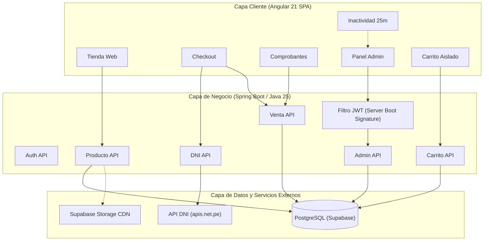
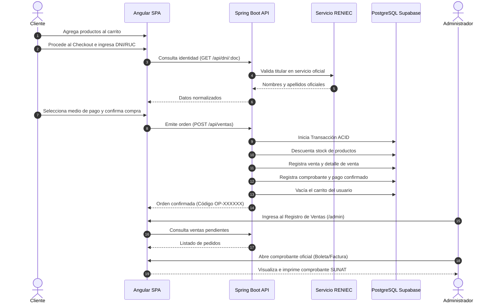
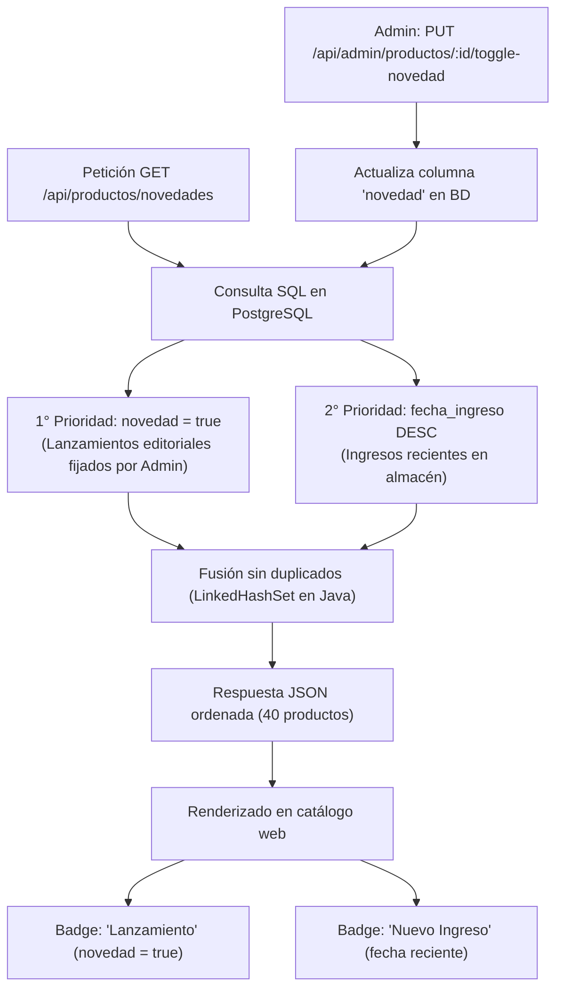
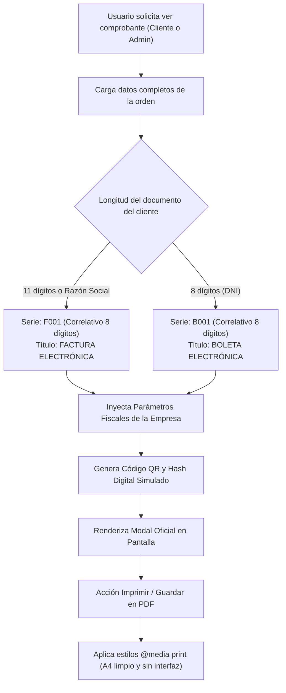
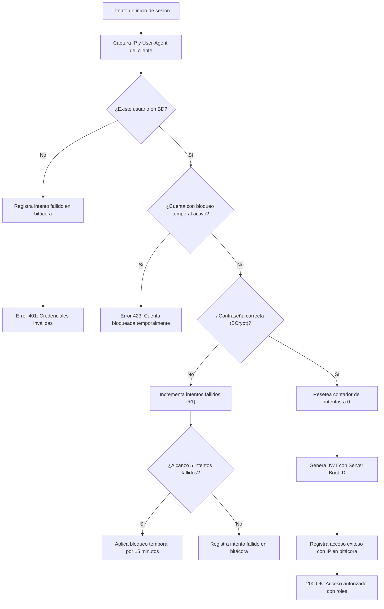
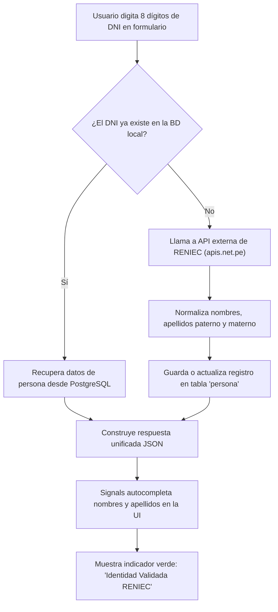
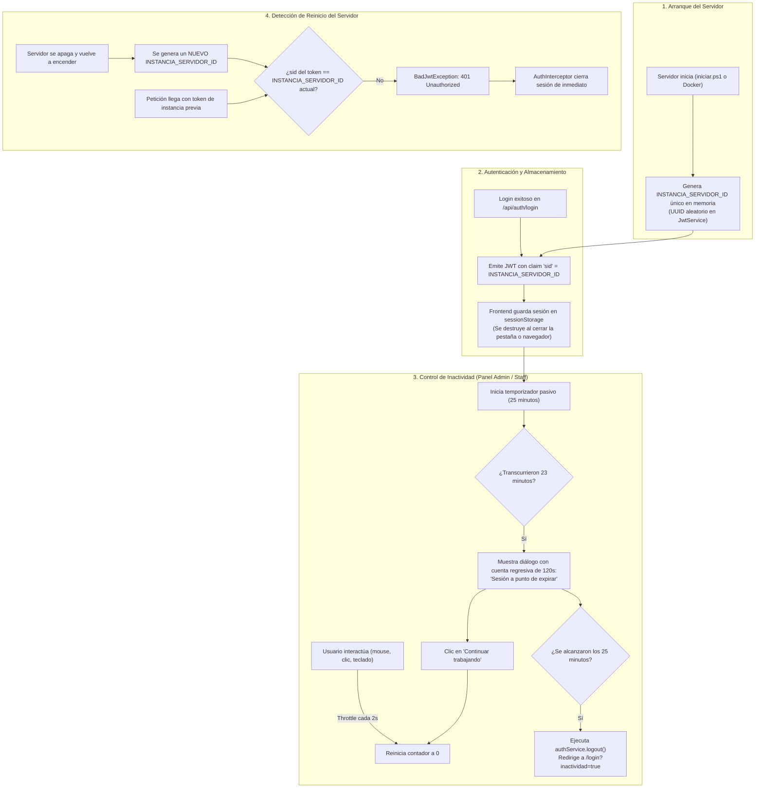
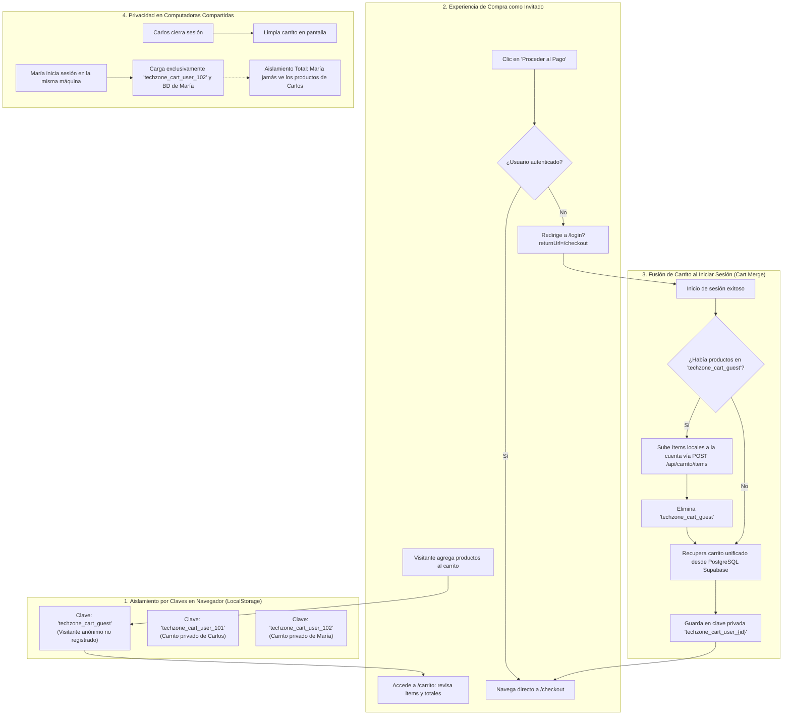
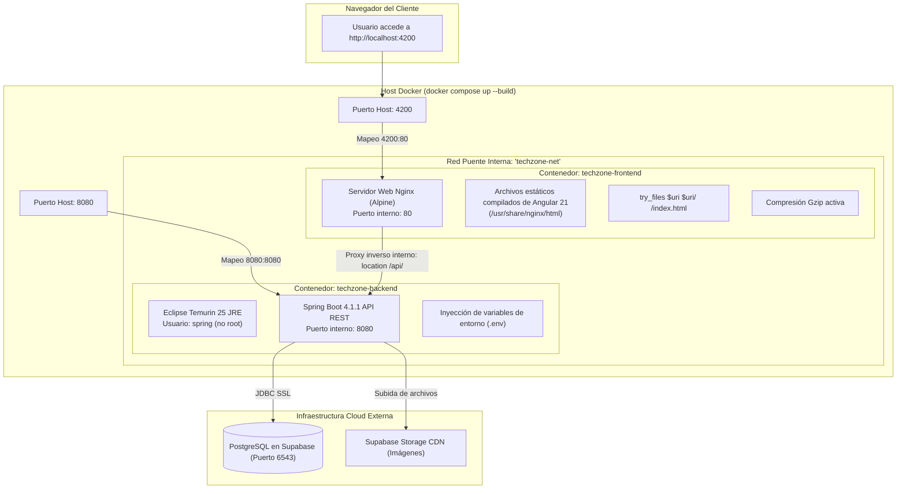

# Sistema de Gestión Integral TechZone · Avance III

**Curso:** Desarrollo Web Integrado  
**Ciclo Académico:** 2026-2 · Ciclo VIII  
**Repositorio Oficial:** [https://github.com/MrCarlos17A/TechZone.git](https://github.com/MrCarlos17A/TechZone.git)  
**Estado del Pipeline CI:** [](https://github.com/MrCarlos17A/TechZone/actions/workflows/ci.yml)  

---

## Integrantes del Proyecto

| N° | Apellidos y Nombres | Código Universitario |
| :---: | :--- | :---: |
| 1 | Arroyo Vega, Carlos Felipe | U23214686 |
| 2 | De La Cruz Becerra, Jesús Miguel | U22321531 |
| 3 | Ipanaque Bravo, Gabriel Arturo | U21209609 |
| 4 | Santamaria Damian, Jose Jhonatan | U23222412 |
| 5 | Suarez Paz, Jhon Antonio | U23257973 |
| 6 | Taboada Mimbela, Gabriela Alexandra | U23271730 |

---

## Descripción del Proyecto

TechZone es una plataforma web integral de comercio electrónico y gestión empresarial (ERP/E-Commerce B2C/B2B) orientada a la comercialización, distribución mayorista/minorista y control logístico de hardware gamer de alta gama (tarjetas gráficas serie RTX 50, monitores OLED/QHD de alta tasa de refresco, procesadores, periféricos y accesorios profesionales).

El proyecto está diseñado bajo una arquitectura desacoplada de dos capas (Monorepo Fullstack) con soporte integral para despliegue containerizado en Docker:
1. **Frontend SPA:** Interfaz moderna y reactiva construida con Angular 21, gestión de estado granular basada en Signals, maquetación con Tailwind CSS, soporte integral para Modo Claro / Modo Oscuro, carrito híbrido con persistencia local aislada por usuario, temporizador de inactividad de 25 minutos para personal administrativo y suite de pruebas unitarias con Vitest.
2. **Backend API REST:** Servidor robusto desarrollado en Java 25 con Spring Boot 4.1.1, autenticación stateless mediante JWT con firma de ciclo de vida de instancia del servidor (Server Boot Signature), control de accesos por roles (RBAC), gestión de parámetros fiscales SUNAT, persistencia transaccional sobre PostgreSQL en Supabase, almacenamiento multimedia seguro en Supabase Storage y suite de pruebas unitarias con JUnit 5 y Mockito.
3. **Orquestación en Contenedores:** Configuración completa mediante Docker y Docker Compose para levantar frontend (Nginx) y backend (JVM Temurin) con un único comando sin requerir dependencias locales.

---

## Estructura del Repositorio (Monorepo)

```text
TechZone/
├── docker-compose.yml                          # Orquestación de contenedores (Frontend Nginx + Backend Spring Boot)
├── backend-techzone/                           # API REST - Spring Boot (Java 25)
│   ├── Dockerfile                              # Multi-stage build con Eclipse Temurin (JDK 25 compilador + JRE 25 ejecutor)
│   ├── .dockerignore                           # Exclusión de artefactos compilados, .env y temporales
│   ├── src/main/java/com/tienda/backend_techzone/
│   │   ├── Controller/                         # Endpoints REST agrupados en /api (Auth, Producto, Venta, DNI, Carrito, Admin)
│   │   ├── Model/                              # Entidades JPA (Persona, Usuario, Cliente, Empleado, Producto, Venta, Pago, ConfiguracionSitio)
│   │   ├── Repository/                         # Acceso a datos Spring Data JPA y consultas especializadas
│   │   ├── Service/                            # Lógica de negocio, novedades híbridas, ventas, configuración y transacciones ACID
│   │   ├── Security/                           # Spring Security, filtros JWT con Server Boot ID, hashing BCrypt y control RBAC
│   │   └── BackendTechzoneApplication.java     # Clase principal de arranque de Spring Boot
│   ├── src/test/java/com/tienda/backend_techzone/
│   │   ├── Security/JwtServiceTest.java        # Pruebas unitarias de emisión, validación y expiración de tokens
│   │   └── Service/
│   │       ├── DniServiceTest.java             # Pruebas de consulta y normalización de identidad
│   │       ├── ProductoServiceTest.java        # Pruebas de catálogo, destacados y novedades
│   │       └── VentaServiceTest.java           # Pruebas de órdenes, totales, IGV y ciclo de estados
│   ├── src/main/resources/
│   │   └── application.properties              # Configuración de base de datos Supabase, pool Hikari y JWT
│   ├── src/test/resources/
│   │   └── application.properties              # Configuración aislada con H2 en memoria para pruebas
│   ├── iniciar.ps1                             # Script de arranque automatizado local con detección de Java 25
│   ├── mvnw / mvnw.cmd                         # Maven Wrapper oficial
│   └── pom.xml                                 # Dependencias del proyecto (Spring Boot, JPA, JWT, Postgres)
│
├── frontend-techzone/                          # Cliente Web SPA - Angular 21
│   ├── Dockerfile                              # Multi-stage build con Node 22 (compilación) y Nginx Alpine (servidor web)
│   ├── nginx.conf                              # Configuración Nginx: SPA routing (try_files), compresión Gzip y proxy a /api/
│   ├── .dockerignore                           # Exclusión de node_modules, dist y temporales
│   ├── src/app/
│   │   ├── pages/                              # Vistas principales de la aplicación
│   │   │   ├── home/                           # Página principal y catálogo de destacados (9 ítems)
│   │   │   ├── novedades/                      # Módulo de novedades híbridas (lanzamientos y recientes)
│   │   │   ├── productos/                      # Catálogo interactivo con filtros (categoría, marca, precio)
│   │   │   ├── producto-detalle/               # Ficha técnica, galería de imágenes y compras directas
│   │   │   ├── carrito/                        # Carrito híbrido persistente con soporte para visitantes e inicio de pago
│   │   │   ├── checkout/                       # Pasarela de compra con validación DNI/RENIEC y selección de pago
│   │   │   ├── login/                          # Autenticación, redirección inteligente y control de expiración
│   │   │   ├── registro/                       # Alta de nuevos clientes con verificación de identidad
│   │   │   ├── perfil/                         # Gestión de datos personales del usuario autenticado
│   │   │   ├── mis-pedidos/                    # Historial de compras y visor de comprobantes oficiales SUNAT
│   │   │   └── admin/                          # Panel backoffice con gestión fiscal, inventario y conteos en tiempo real
│   │   ├── components/                         # Componentes reutilizables de UI (Navbar, Footer, Tarjetas, Toasts)
│   │   ├── services/                           # Servicios HTTP reactivos y estado global con Signals
│   │   │   ├── auth.service.ts                 # Autenticación, sesión volátil en sessionStorage y handshake /me
│   │   │   ├── carrito.service.ts              # Carrito persistente con aislamiento estricto por usuario y fusión
│   │   │   ├── inactividad.service.ts          # Temporizador de 25 minutos para personal administrativo con aviso preventivo
│   │   │   ├── configuracion.service.ts        # Datos comerciales y parámetros tributarios SUNAT
│   │   │   └── ...                             # Servicios de productos, ventas, temas y notificaciones
│   │   ├── interceptors/                       # Interceptor HTTP con inyección Bearer y logout inmediato ante 401
│   │   └── models/                             # Interfaces TypeScript y tipado estricto del dominio
│   ├── src/app/pages/mis-pedidos/
│   │   └── mis-pedidos.component.spec.ts       # Pruebas unitarias de comprobantes electrónicos con Vitest
│   ├── src/styles.css                          # Estilos globales y reglas de impresión oficial (@media print)
│   ├── package.json                            # Dependencias npm (Angular 21, Tailwind CSS, Vitest)
│   └── angular.json                            # Configuración de compilación de Angular
│
├── .github/                                    # Automatización CI/CD con GitHub Actions
│   └── workflows/ci.yml                        # Pipeline de integración continua (Spring Boot + Angular)
├── .gitignore                                  # Reglas maestras de exclusión (.env, target, dist, node_modules)
└── README.md                                   # Documentación técnica, diagramas de flujo y manual operativo
```

---

## Flujos y Arquitectura del Sistema

### 1. Arquitectura General y Comunicación entre Capas

**Descripción del Flujo:**  
TechZone implementa una arquitectura desacoplada en tres capas principales: la capa de presentación (Angular 21 SPA), la capa de servicios de negocio (Spring Boot REST API) y la capa de persistencia en la nube (PostgreSQL y Supabase Storage). El cliente gestiona el estado reactivo mediante Signals y se comunica exclusivamente vía JSON mediante peticiones HTTP asíncronas hacia el backend, el cual valida las credenciales y autorizaciones antes de interactuar con la base de datos relacional.



**Guía de Componentes:**
* **Angular 21 SPA:** Interfaz de usuario que consume la API REST. Gestiona el enrutamiento del lado del cliente, almacenamiento en `sessionStorage` y persistencia local de carritos con `localStorage`.
* **Spring Boot API (Java 25):** Controlador central de lógica de negocio, validaciones transaccionales y emisión/verificación de tokens JWT firmados con HMAC-SHA256.
* **PostgreSQL (Supabase):** Almacén relacional transaccional (ACID) que custodia usuarios, productos, pedidos, pagos, parámetros fiscales y registros de auditoría.

---

### 2. Ciclo de Vida de una Venta, Pago y Despacho

**Descripción del Flujo:**  
Describe la secuencia completa desde que un cliente emite una compra en el Checkout hasta la verificación del pago y emisión del comprobante por el administrador. Todas las operaciones de descuento de inventario, registro de cabecera de venta, detalle y comprobante se ejecutan bajo una transacción atómica; si cualquier paso falla, se realiza un rollback automático.



**Etapas del Ciclo Logístico:**
1. **Validación de Identidad:** Verificación de DNI en RENIEC para evitar fraudes en comprobantes.
2. **Transacción ACID:** Bloqueo y descuento de stock en almacén; inserción simultánea en tablas `venta`, `detalle_venta` y `pago`.
3. **Control Operativo:** El personal administrativo inspecciona la transacción y actualiza el estado logístico (`PREPARACION` -> `CAMINO` -> `ENTREGADO`).

---

### 3. Lógica del Algoritmo de Novedades Híbridas

**Descripción del Flujo:**  
Para la sección de Novedades (`/novedades`), el sistema combina el criterio editorial manual con la llegada automática de mercadería reciente a los almacenes de TechZone. Esto garantiza que los lanzamientos promocionales tengan visibilidad prioritaria sin descuidar los últimos ingresos físicos.



**Reglas de Ordenamiento:**
* **Prioridad 1 (Editorial):** Productos marcados con `novedad = true` por el administrador aparecen primero con el badge *"Lanzamiento"*.
* **Prioridad 2 (Cronológica):** Productos ordenados por `fecha_ingreso DESC` complementan la lista con el badge *"Nuevo Ingreso"*.
* **Garantía de Unicidad:** `LinkedHashSet` en la capa de servicios de Spring Boot evita que un producto aparezca duplicado si coincide en ambas condiciones.

---

### 4. Ciclo de Facturación Electrónica y Representación Impresa (SUNAT)

**Descripción del Flujo:**  
Generación de la representación impresa del comprobante tributario conforme a la normativa SUNAT. El sistema clasifica automáticamente el tipo de documento según la longitud y naturaleza del documento del titular, ensamblando los parámetros fiscales registrados en la configuración de la empresa.



**Parámetros Fiscales Inyectados:**
* **Emisor:** R.U.C. 20608945123 · TECHZONE GAMING STORE S.A.C.
* **Sede Fiscal:** Av. Javier Prado Este 4200, Santiago de Surco - Lima.
* **Desglose Tributario:** Operación Gravada + I.G.V. (18.00%) = Importe Total.
* **Resolución SUNAT:** Autorizado mediante resolución de intendencia SUNAT para emisión electrónica.

---

### 5. Seguridad Defensiva, Bloqueo de Intentos y Auditoría IP

**Descripción del Flujo:**  
Mecanismo de protección contra ataques de fuerza bruta y accesos no autorizados. Cada intento de inicio de sesión registra la dirección IP y el navegador del cliente en la bitácora forense de la base de datos. Si se detectan 5 intentos consecutivos fallidos sobre una misma cuenta, se activa un bloqueo automático por 15 minutos.



**Tabla de Políticas de Control de Acceso:**
* **Límite de Intentos:** 5 intentos erróneos consecutivos.
* **Tiempo de Bloqueo:** 15 minutos de espera obligatoria antes de permitir un nuevo intento.
* **Trazabilidad:** Cada evento (éxito o fallo) se almacena en la tabla `registro_accesos` con marca de tiempo e IP.

---

### 6. Integración y Validación de Identidad (API DNI y RENIEC)

**Descripción del Flujo:**  
Flujo de validación en tiempo real para agilizar el llenado de formularios y asegurar que los comprobantes tributarios se emitan a nombre de ciudadanos reales. El sistema implementa una caché local en PostgreSQL para consultas repetidas y recurre al servicio externo de RENIEC ante documentos no registrados previamente.



**Puntos de Integración:**
1. Formulario de Registro de Nuevos Clientes (`/registro`).
2. Pasarela de Checkout de Compras (`/checkout`).
3. Formulario de Mi Perfil (`/perfil`).
4. Módulo de Alta de Colaboradores en Backoffice (`/admin`).

---

### 7. Ciclo de Vida de Sesión, Inactividad de 25 Minutos y Firma de Instancia

**Descripción del Flujo:**  
Protección de sesiones ante dos riesgos críticos: abandono del equipo en el panel administrativo y persistencia indebida de sesiones tras apagados del servidor. Implementa un identificador único de instancia en memoria (`INSTANCIA_SERVIDOR_ID`), almacenamiento volátil en `sessionStorage` y un temporizador pasivo de inactividad de 25 minutos para personal administrativo con modal de aviso preventivo.



**Detalle de Políticas de Sesión:**
* **Server Boot Signature:** Cada vez que el backend arranca, se genera un UUID único en memoria. Si el servidor se apaga o reinicia, cualquier token emitido en una sesión previa es rechazado automáticamente con `401 Unauthorized`.
* **Almacenamiento Volátil (`sessionStorage`):** Al cerrar la pestaña o el navegador, la sesión se destruye por completo por el propio navegador, protegiendo al usuario si abandona el equipo.
* **Temporizador de 25 Minutos (Staff):** Monitorea pasivamente el uso de periféricos. Al minuto 23 muestra un modal preventivo con cuenta regresiva de 120 segundos; si no hay respuesta al minuto 25, cierra la sesión. Los clientes de la tienda mantienen su sesión continua de 8 horas para no interrumpir compras.

---

### 8. Arquitectura del Carrito Híbrido Persistente y Aislamiento por Usuario

**Descripción del Flujo:**  
Garantiza que ningún cliente pierda sus productos seleccionados si cierra sesión, se le apaga el servidor o abandona temporalmente la página, manteniendo al mismo tiempo un **aislamiento absoluto e independiente entre diferentes usuarios** en una misma computadora compartida.



**Reglas del Carrito Híbrido:**
* **Aislamiento por Prefijo (*Namespacing*):** Cada usuario registrado almacena sus datos en `techzone_cart_user_{idUsuario}`. Si dos personas distintas inician sesión en la misma máquina, sus carritos nunca se cruzan.
* **Fusión Inteligente (*Cart Merge*):** Los productos agregados como invitado se transfieren automáticamente a la cuenta del usuario al autenticarse, eliminando la clave temporal de invitado.
* **Regla de Limpieza:** El carrito nunca se vacía por cerrar sesión o expirar el token. Solo se vacía cuando el usuario pulsa *"Vaciar Carrito"* o cuando la compra se concreta con éxito en el Checkout.

---

### 9. Arquitectura de Containerización con Docker Compose y Nginx

**Descripción del Flujo:**  
Estructura de despliegue contenerizado que permite levantar la plataforma completa con un único comando. El frontend se empaqueta en una imagen de Nginx Alpine optimizada con soporte para enrutamiento SPA y compresión Gzip, mientras que el backend corre sobre una máquina virtual Java 25 de Eclipse Temurin ejecutada con un usuario de sistema sin privilegios.



**Detalle de la Red y Contenedores:**
* **`techzone-frontend`:** Construido en multi-stage con Node 22 (etapa builder) y Nginx Alpine (etapa runner). Expone el puerto `80` mapeado al puerto `4200` del host. Cuenta con proxy inverso configurado en `/api/` hacia `http://backend:8080/api/`.
* **`techzone-backend`:** Construido en multi-stage con Eclipse Temurin JDK 25 (etapa builder) y JRE 25 (etapa runner). Ejecuta bajo el usuario `spring:spring` (UID 1001) para máxima seguridad. Expone el puerto `8080`.
* **`techzone-net`:** Red tipo bridge que comunica ambos contenedores internamente mediante resolución de nombres DNS de Docker.

---

## Matriz de Roles, Políticas de Inactividad y Permisos (RBAC)

| Rol | Ámbito | Política de Inactividad | Permisos y Capacidades |
| :--- | :--- | :--- | :--- |
| **Administrador** (`ROLE_ADMINISTRADOR`) | Panel Completo (`/admin/**`) | **25 minutos de inactividad física** (aviso preventivo de 120s al min 23). | Control total de inventario, fijado de novedades editoriales, configuración tributaria del sitio (RUC, razón social, dirección fiscal), inspección y emisión de comprobantes, gestión de proveedores, colaboradores, usuarios y auditoría forense con trazabilidad de IP. |
| **Colaborador** (`ROLE_TRABAJADOR`) | Operativo & Ventas (`/admin/**`) | **25 minutos de inactividad física** (aviso preventivo de 120s al min 23). | Despacho de órdenes de compra, consulta de inventario y stock crítico, verificación de transacciones de pago, visualización de comprobantes fiscales y consulta de clientes. Módulos de auditoría y configuración bloqueados. |
| **Cliente** (`ROLE_CLIENTE`) | Tienda Pública (`/`) | **8 horas continuas** (sin corte por inactividad física; se destruye al cerrar la pestaña). | Catálogo interactivo con filtros, sección de novedades, carrito híbrido persistente con aislamiento por cuenta, checkout digital con validación de DNI/RUC, pasarela de pago, historial en "Mis Pedidos" y visor de comprobantes electrónicos oficiales. |

---

## Catálogo de Endpoints REST (API Reference)

| Método | Endpoint | Acceso | Descripción |
| :--- | :--- | :---: | :--- |
| `POST` | `/api/auth/login` | Público | Autenticación de credenciales, control de intentos y generación de JWT con Server Boot ID. |
| `POST` | `/api/auth/registro` | Público | Alta de nuevo cliente en la plataforma con validación previa de identidad. |
| `GET` | `/api/auth/me` | Autenticado | Endpoint de handshake para validar vigencia e instancia activa del token. |
| `GET` | `/api/configuracion` | Público | Obtiene los datos comerciales y parámetros tributarios SUNAT de la empresa. |
| `PUT` | `/api/admin/configuracion` | Admin | Actualiza logotipo, RUC fiscal, razón social, dirección y leyenda oficial SUNAT. |
| `GET` | `/api/productos` | Público | Listado paginado de catálogo con filtros de categoría, marca y stock. |
| `GET` | `/api/productos/destacados` | Público | Obtiene los 9 productos destacados para la portada de inicio. |
| `GET` | `/api/productos/novedades` | Público | Lista ordenada bajo lógica híbrida (fijados manuales + ingresos recientes). |
| `PUT` | `/api/admin/productos/{id}/toggle-novedad` | Admin | Alterna la marca editorial de novedad de un producto. |
| `GET` | `/api/dni/{numero}` | Público | Consulta de documento de identidad con validación en RENIEC. |
| `GET` | `/api/carrito` | Autenticado | Obtiene los ítems y totales del carrito sincronizados en la base de datos. |
| `POST` | `/api/carrito/items` | Autenticado | Agrega o incrementa un producto en el carrito de la cuenta activa. |
| `PUT` | `/api/carrito/items/{id}`| Autenticado | Actualiza la cantidad de un ítem en el carrito del usuario. |
| `DELETE`| `/api/carrito/items/{id}`| Autenticado | Elimina un ítem específico del carrito del usuario. |
| `DELETE`| `/api/carrito` | Autenticado | Vacía por completo el carrito de la cuenta activa. |
| `POST` | `/api/ventas` | Autenticado | Creación de orden de compra, descuento de stock y registro de pago. |
| `GET` | `/api/ventas/mis-pedidos` | Autenticado | Historial de órdenes realizadas por el cliente autenticado. |
| `GET` | `/api/ventas/mis-pedidos/{id}` | Autenticado | Detalle completo de orden y comprobante fiscal del cliente. |
| `GET` | `/api/admin/ventas/{id}` | Admin / Colab | Detalle de venta y datos completos de transacción para panel admin. |
| `PATCH`| `/api/admin/ventas/{id}/estado` | Admin / Colab | Actualiza el estado logístico del pedido (PREPARACION, CAMINO, ENTREGADO). |

---

## Calidad de Software y Automatización CI/CD

El repositorio cuenta con integración continua automatizada mediante **GitHub Actions** configurada en `.github/workflows/ci.yml`. Cada confirmación a la rama `main` ejecuta en paralelo los flujos de validación:

### Resumen de Pruebas Automatizadas
* **Backend (Java 25 + Spring Boot + JUnit 5 + Mockito):**
  * `JwtServiceTest`: Emisión, validación y expiración de tokens seguros con identificación de instancia.
  * `DniServiceTest`: Consumo de API externa, sanitización y caché local.
  * `ProductoServiceTest`: Filtrado de productos vigentes, listado de novedades y toggle de estado.
  * `VentaServiceTest`: Registro de compras, cálculo de subtotal, IGV (18%), total y ciclo de estados.
  * *Resultado:* 16 pruebas ejecutadas exitosamente con base de datos H2 en memoria.
* **Frontend (Angular 21 + Vitest):**
  * `mis-pedidos.component.spec.ts`: Detección de Boleta vs Factura, carga de comprobante y generación de hash digital.
  * `producto-detalle.component.spec.ts`: Inicialización de componentes, galería de fotos y navegación.
  * `toast.service.spec.ts` y `tema.service.spec.ts`: Gestión de notificaciones y cambio de tema Claro / Oscuro.
  * `app.spec.ts`: Montaje general de la aplicación SPA con inyección de monitoreo de inactividad.
  * *Resultado:* 17 pruebas unitarias ejecutadas con éxito al 100%.

---

## Guía de Puesta en Marcha

### Opción 1: Despliegue con Docker Compose (Recomendado)
Levanta toda la infraestructura (Frontend en Nginx + Backend en Spring Boot) con un solo comando, sin requerir la instalación previa de Java 25, Maven ni Node.js en la máquina host:

```bash
docker compose up --build
```
*(O `docker-compose up --build` en versiones clásicas)*

* **Frontend (Angular + Nginx):** `http://localhost:4200`
* **Backend (Spring Boot API):** `http://localhost:8080`

Para detener los contenedores:
```bash
docker compose down
```

---

### Opción 2: Ejecución Local Rápida (Desarrollo Nativo)

#### 1. Requisitos del Entorno
* **Java Development Kit (JDK):** Java 25 configurado en `JAVA_HOME`.
* **Node.js:** Versión 20+ o 22 con gestor `npm`.
* **PostgreSQL:** Instancia activa en Supabase (Transaction Pooler - Puerto 6543).

#### 2. Configuración de Variables (`backend-techzone/.env`)
Copia la plantilla `.env.example` en `backend-techzone/` como `.env` y define tus credenciales:
```bash
cd backend-techzone
cp .env.example .env
```

#### 3. Ejecución del Backend
```powershell
cd backend-techzone
.\iniciar.ps1
```
*API REST disponible en:* `http://localhost:8080`

#### 4. Ejecución del Frontend
```bash
cd frontend-techzone
npm install
npm start
```
*Aplicación web disponible en:* `http://localhost:4200`
