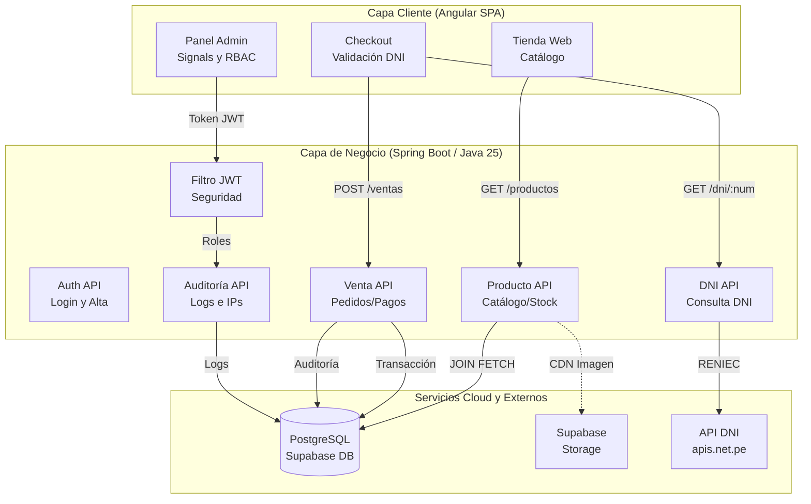
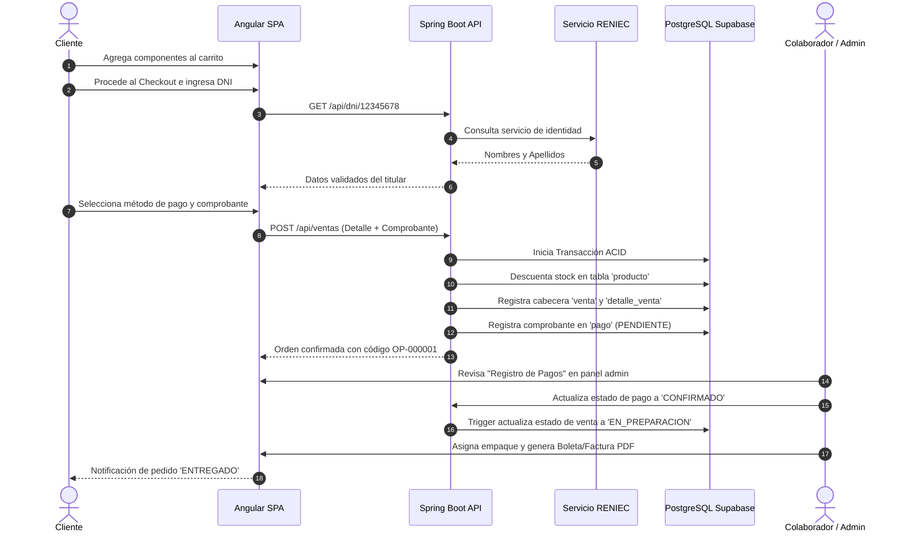
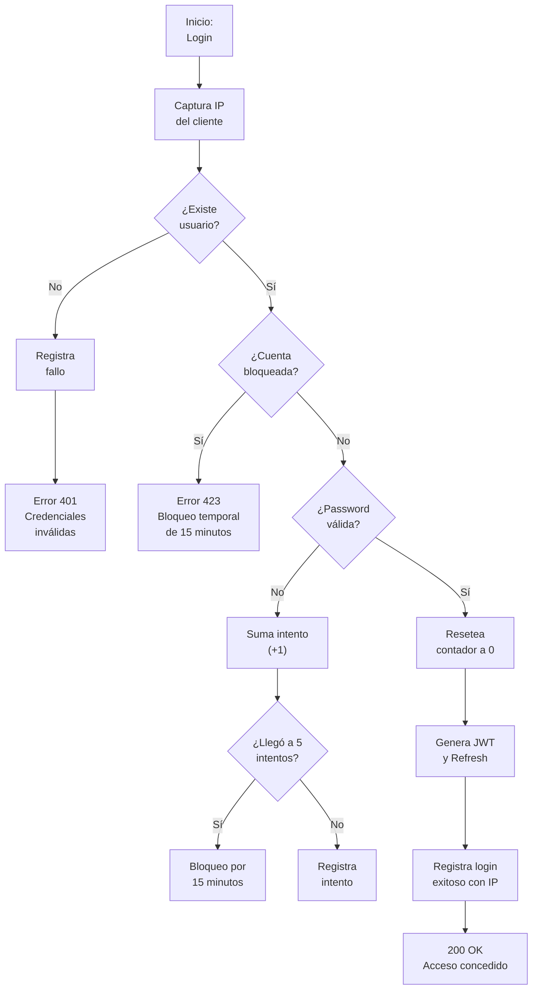

# Sistema de Gestión Integral TechZone · Avance III

**Curso:** Desarrollo Web Integrado  
**Ciclo Académico:** 2026-2 · Ciclo VIII  
**Repositorio Oficial:** [https://github.com/MrCarlos17A/TechZone.git](https://github.com/MrCarlos17A/TechZone.git)  

---

## Integrantes del Proyecto

| N° | Apellidos y Nombres | Código Universitario |
| :---: | :--- | :---: |
| 1 | Arroyo Vega, Carlos Felipe | U23214686 |
| 2 | De La Cruz Becerra, Jesús Miguel | U22321531 |
| 3 | Ipanaque Bravo, Gabriel Arturo | U21209609 |
| 4 | Santamaria Damian, Jose Jhonatan | U23222412 |
| 5 | Suarez Paz, Jhon Antonio | U23257973 |
| 6 | Taboada Mimbela, Gabriela Alexandra | U23271730 |

---

## Descripción del Proyecto

TechZone es una plataforma web integral de comercio electrónico y gestión empresarial (ERP/E-Commerce B2C/B2B) orientada a la comercialización, distribución mayorista/minorista y control logístico de hardware gamer de alta gama (tarjetas gráficas serie RTX 50, monitores OLED/QHD de alta tasa de refresco, procesadores, periféricos y accesorios profesionales).

El proyecto está diseñado bajo una arquitectura desacoplada de dos capas (Monorepo Fullstack):
1. **Frontend SPA:** Interfaz moderna y reactiva construida con Angular 19 / 21, gestión de estado granular basada en Signals, maquetación con Tailwind CSS, soporte integral para Modo Claro / Modo Oscuro y renderizado responsive de alta definición.
2. **Backend API REST:** Servidor robusto desarrollado en Java 25 con Spring Boot, autenticación stateless mediante JWT, control de accesos por roles (RBAC), persistencia transaccional sobre PostgreSQL en Supabase y almacenamiento multimedia seguro en Supabase Storage.

---

## Estructura del Repositorio (Monorepo)

```text
TechZone/
├── backend-techzone/                           # API REST - Spring Boot (Java 25)
│   ├── src/main/java/com/tienda/backend_techzone/
│   │   ├── Controller/                         # Endpoints REST (Auth, Producto, Venta, DNI, Auditoría, Admin)
│   │   ├── Model/                              # Entidades JPA (Persona, Usuario, Cliente, Empleado, Producto, Venta)
│   │   ├── Repository/                         # Acceso a datos Spring Data JPA y consultas JOIN FETCH
│   │   ├── Service/                            # Lógica de negocio, transacciones ACID y reglas operativas
│   │   ├── Security/                           # Spring Security, filtros JWT, hashing BCrypt y control RBAC
│   │   └── BackendTechzoneApplication.java     # Clase principal de arranque de Spring Boot
│   ├── src/main/resources/
│   │   └── application.properties              # Configuración de base de datos Supabase, pooler y puerto
│   ├── .env.example                            # Plantilla de variables de entorno para desarrollo
│   ├── iniciar.ps1                             # Script de arranque automatizado con detección de Java 25
│   ├── mvnw / mvnw.cmd                         # Maven Wrapper oficial
│   └── pom.xml                                 # Dependencias del proyecto (Spring Boot, JPA, JWT, Postgres)
│
├── frontend-techzone/                          # Cliente Web SPA - Angular 19 / 21
│   ├── src/app/
│   │   ├── pages/                              # Vistas principales de la aplicación
│   │   │   ├── home/                           # Página principal, banners promocionales y destacados
│   │   │   ├── productos/                      # Catálogo interactivo con filtros (categoría, marca, precio)
│   │   │   ├── producto-detalle/               # Ficha técnica, galería de imágenes y selector de compra
│   │   │   ├── carrito/                        # Gestión del carrito de compras y cálculo de totales
│   │   │   ├── checkout/                       # Pasarela de compra con validación de DNI en RENIEC y pagos
│   │   │   ├── login/                          # Autenticación de usuarios y colaboradores
│   │   │   ├── registro/                       # Alta de nuevos clientes con verificación de identidad
│   │   │   ├── perfil/                         # Gestión de datos personales del usuario autenticado
│   │   │   ├── mis-pedidos/                    # Historial y seguimiento de órdenes de compra
│   │   │   └── admin/                          # Backoffice administrativo integral (Ventas, Inventario, Auditoría)
│   │   ├── components/                         # Componentes reutilizables de UI
│   │   │   ├── navbar/                         # Barra de navegación con buscador, carrito y sesión
│   │   │   ├── footer/                         # Pie de página institucional y enlaces de soporte
│   │   │   ├── product-card/                   # Tarjeta de producto con efecto hover y botón de compra
│   │   │   └── toast-container/                # Notificaciones dinámicas de éxito, advertencia y error
│   │   ├── services/                           # Servicios HTTP reactivos y estado global con Signals
│   │   ├── interceptors/                       # Interceptor HTTP para inyección automática del token JWT
│   │   └── models/                             # Interfaces TypeScript y tipado estricto del dominio
│   ├── src/assets/                             # Recursos estáticos (logos, tipografías e iconografía)
│   ├── angular.json                            # Configuración del compilador y bundles de Angular CLI
│   ├── package.json                            # Dependencias npm (Angular, Tailwind CSS, Chart.js)
│   └── tailwind.config.js                      # Configuración de diseño responsivo y temas Claro / Oscuro
│
├── .gitignore                                  # Reglas maestras de exclusión (secretos .env, .sql, target, dist)
└── README.md                                   # Documentación técnica, diagramas de flujo y manual de despliegue
```

---

## Flujos y Arquitectura del Sistema

### 1. Arquitectura General y Comunicación entre Capas


---

### 2. Ciclo de Vida de una Venta (Checkout, Pago y Despacho)


---

### 3. Seguridad Defensiva, Bloqueo de Intentos y Auditoría IP


---

## Matriz de Roles y Permisos (RBAC)

| Rol | Ámbito | Permisos y Capacidades |
| :--- | :--- | :--- |
| **Administrador** (`ROLE_ADMINISTRADOR`) | Panel Completo (`/admin/**`) | Control total de inventario, órdenes de venta, proveedores, colaboradores, configuración del sitio, auditoría forense con trazabilidad de IP, roles y permisos. Autorizado para restaurar eliminaciones accidentales. |
| **Colaborador** (`ROLE_TRABAJADOR`) | Operativo & Ventas (`/admin/**`) | Despacho de pedidos, consulta de inventario y stock crítico, registro de ventas, emisión de boletas/facturas electrónicas y consulta de clientes. Botones de eliminación permanente bloqueados y sin acceso a módulos de auditoría ni configuración. |
| **Cliente** (`ROLE_CLIENTE`) | Tienda Pública (`/`) | Catálogo interactivo con filtros, carrito sincronizado, checkout digital con validación de DNI/RUC, pasarela de pagos (Yape, Plin, Tarjetas) y panel "Mis Pedidos / Mi Perfil". |

---

## Catálogo de Endpoints REST (API Reference)

| Método | Endpoint | Acceso | Descripción |
| :--- | :--- | :---: | :--- |
| `POST` | `/api/auth/login` | Público | Autenticación de credenciales, control de intentos y generación de JWT. |
| `POST` | `/api/auth/registro` | Público | Alta de nuevo cliente en la plataforma con validación previa de identidad. |
| `GET` | `/api/auth/perfil` | Autenticado | Obtiene los datos del usuario en sesión a partir del token JWT. |
| `GET` | `/api/productos` | Público | Listado paginado de catálogo con filtros de categoría, marca y stock. |
| `GET` | `/api/dni/{numero}` | Público | Consulta de documento de identidad con validación en RENIEC. |
| `POST` | `/api/ventas` | Autenticado | Creación de orden de compra, detalle y registro preliminar de pago. |

---

## Modelo de Datos y Entidades Clave

* **Jerarquía de Identidad:** La entidad central `Persona` almacena nombres, apellidos (paterno y materno), documento y ubigeo. Se hereda hacia `Usuario` (credenciales y rol) y se ramifica en `Cliente` (historial comercial) o `Empleado` (datos de contratación).
* **Matriz de Abastecimiento (`ProductoProveedor`):** Relación M:N que enlaza productos con proveedores oficiales, controlando el costo mayorista (`precio_compra`), margen de beneficio bruto (%) y tiempo de reposición (`tiempo_pedido_dias`).
* **Trazabilidad Inmutable:**
  * `registro_acceso`: Registra cada intento de login con su IP, navegador/agente, fecha y motivo de rechazo.
  * `registro_auditoria`: Bitácora que respalda snapshots en formato JSON (`datos_previos`, `datos_nuevos`), acción realizada, módulo e IP del terminal.

---

## Guía de Puesta en Marcha

### 1. Requisitos del Entorno
* **Java Development Kit (JDK):** Java 25 configurado en `JAVA_HOME`.
* **Node.js:** Versión 18+ con gestor `npm`.
* **PostgreSQL:** Instancia activa en Supabase (Transaction Pooler - Puerto 6543).

### 2. Configuración de Variables (`backend-techzone/.env`)
Copia la plantilla `.env.example` en `backend-techzone/` como `.env` y define tus credenciales locales:
```bash
cd backend-techzone
cp .env.example .env
```

### 3. Ejecución del Backend
```powershell
cd backend-techzone
.\iniciar.ps1
```
*API REST disponible en:* `http://localhost:8080`

### 4. Ejecución del Frontend
```bash
cd frontend-techzone
npm install
npm start
```
*Aplicación web disponible en:* `http://localhost:4200`
