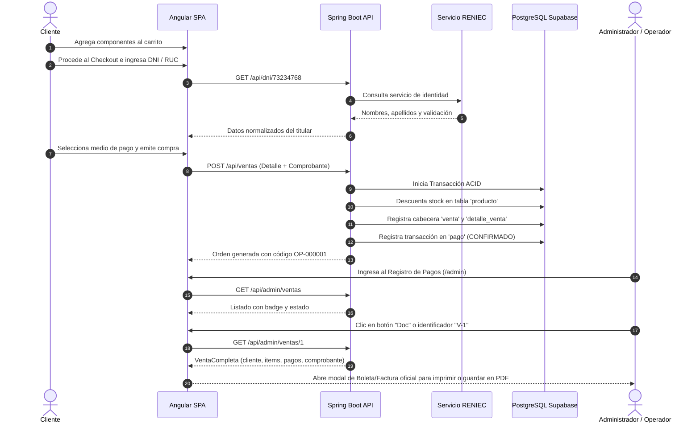
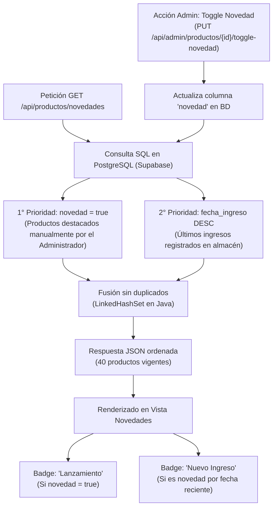
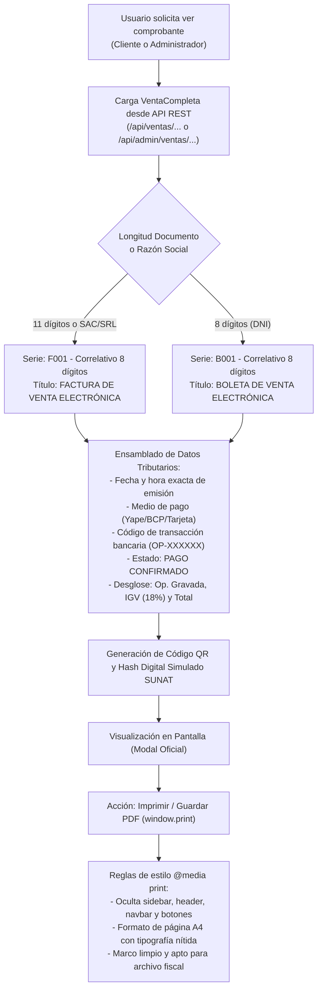
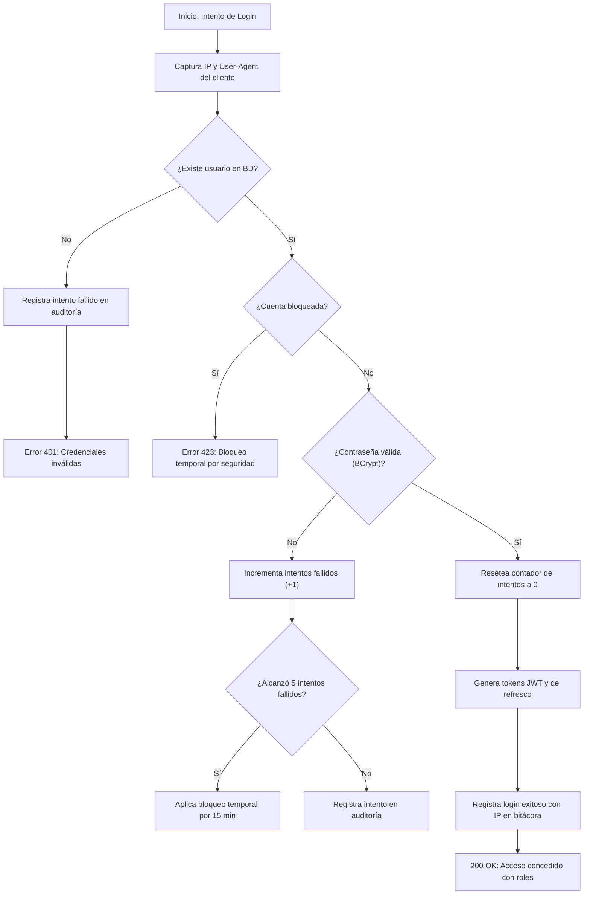
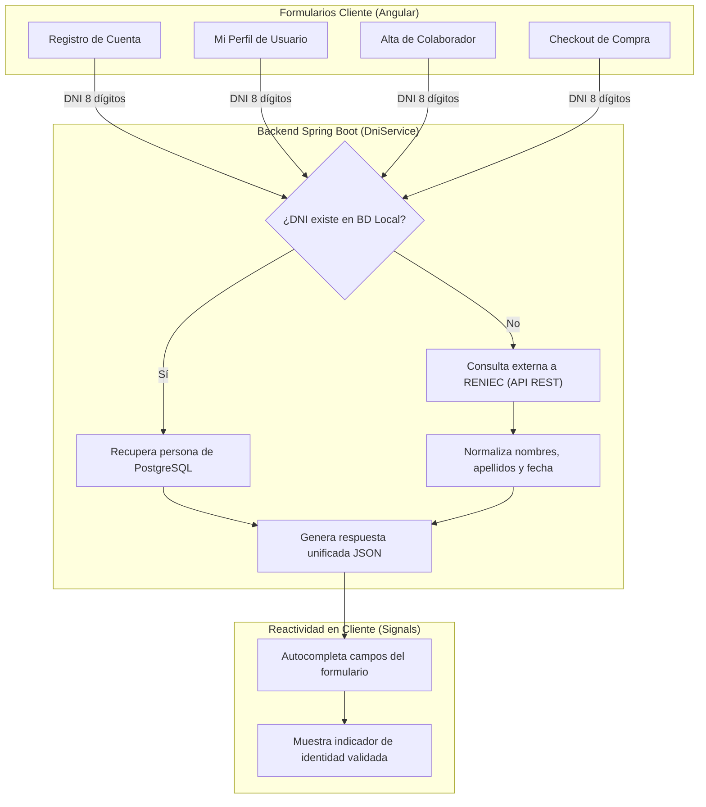

# Sistema de Gestión Integral TechZone · Avance III

**Curso:** Desarrollo Web Integrado  
**Ciclo Académico:** 2026-2 · Ciclo VIII  
**Repositorio Oficial:** [https://github.com/MrCarlos17A/TechZone.git](https://github.com/MrCarlos17A/TechZone.git)  
**Estado del Pipeline CI:** [](https://github.com/MrCarlos17A/TechZone/actions/workflows/ci.yml)  

---

## Integrantes del Proyecto

| N° | Apellidos y Nombres | Código Universitario |
| :---: | :--- | :---: |
| 1 | Arroyo Vega, Carlos Felipe | U23214686 |
| 2 | De La Cruz Becerra, Jesús Miguel | U22321531 |
| 3 | Ipanaque Bravo, Gabriel Arturo | U21209609 |
| 4 | Santamaria Damian, Jose Jhonatan | U23222412 |
| 5 | Suarez Paz, Jhon Antonio | U23257973 |
| 6 | Taboada Mimbela, Gabriela Alexandra | U23271730 |

---

## Descripción del Proyecto

TechZone es una plataforma web integral de comercio electrónico y gestión empresarial (ERP/E-Commerce B2C/B2B) orientada a la comercialización, distribución mayorista/minorista y control logístico de hardware gamer de alta gama (tarjetas gráficas serie RTX 50, monitores OLED/QHD de alta tasa de refresco, procesadores, periféricos y accesorios profesionales).

El proyecto está diseñado bajo una arquitectura desacoplada de dos capas (Monorepo Fullstack):
1. **Frontend SPA:** Interfaz moderna y reactiva construida con Angular 21, gestión de estado granular basada en Signals, maquetación con Tailwind CSS, soporte integral para Modo Claro / Modo Oscuro, renderizado responsive y suite de pruebas unitarias con Vitest.
2. **Backend API REST:** Servidor robusto desarrollado en Java 25 con Spring Boot, autenticación stateless mediante JWT, control de accesos por roles (RBAC), persistencia transaccional sobre PostgreSQL en Supabase, almacenamiento multimedia seguro en Supabase Storage y suite de pruebas unitarias con JUnit 5 y Mockito.

---

## Estructura del Repositorio (Monorepo)

```text
TechZone/
├── backend-techzone/                           # API REST - Spring Boot (Java 25)
│   ├── src/main/java/com/tienda/backend_techzone/
│   │   ├── Controller/                         # Endpoints REST agrupados en /api (Auth, Producto, Venta, DNI, Admin)
│   │   ├── Model/                              # Entidades JPA (Persona, Usuario, Cliente, Empleado, Producto, Venta, Pago)
│   │   ├── Repository/                         # Acceso a datos Spring Data JPA y consultas especializadas
│   │   ├── Service/                            # Lógica de negocio, novedades híbridas, ventas y transacciones ACID
│   │   ├── Security/                           # Spring Security, filtros JWT, hashing BCrypt y control RBAC
│   │   └── BackendTechzoneApplication.java     # Clase principal de arranque de Spring Boot
│   ├── src/test/java/com/tienda/backend_techzone/
│   │   ├── Security/JwtServiceTest.java        # Pruebas unitarias de emisión y validación de tokens
│   │   └── Service/
│   │       ├── DniServiceTest.java             # Pruebas de consulta y normalización de identidad
│   │       ├── ProductoServiceTest.java        # Pruebas de catálogo, destacados y novedades
│   │       └── VentaServiceTest.java           # Pruebas de órdenes, totales, IGV y ciclo de estados
│   ├── src/main/resources/
│   │   └── application.properties              # Configuración de base de datos Supabase y credenciales
│   ├── src/test/resources/
│   │   └── application.properties              # Configuración aislada con H2 en memoria para pruebas
│   ├── iniciar.ps1                             # Script de arranque automatizado con detección de Java 25
│   ├── mvnw / mvnw.cmd                         # Maven Wrapper oficial
│   └── pom.xml                                 # Dependencias del proyecto (Spring Boot, JPA, JWT, Postgres)
│
├── frontend-techzone/                          # Cliente Web SPA - Angular 21
│   ├── src/app/
│   │   ├── pages/                              # Vistas principales de la aplicación
│   │   │   ├── home/                           # Página principal y catálogo de destacados (9 ítems)
│   │   │   ├── novedades/                      # Módulo de novedades híbridas (lanzamientos y recientes)
│   │   │   ├── productos/                      # Catálogo interactivo con filtros (categoría, marca, precio)
│   │   │   ├── producto-detalle/               # Ficha técnica, galería de imágenes y selector de compra
│   │   │   ├── carrito/                        # Gestión del carrito de compras y cálculo de totales
│   │   │   ├── checkout/                       # Pasarela de compra con validación DNI/RENIEC y selección de pago
│   │   │   ├── login/                          # Autenticación de usuarios y colaboradores
│   │   │   ├── registro/                       # Alta de nuevos clientes con verificación de identidad
│   │   │   ├── perfil/                         # Gestión de datos personales del usuario autenticado
│   │   │   ├── mis-pedidos/                    # Historial de compras y visor de comprobantes oficiales SUNAT
│   │   │   └── admin/                          # Panel backoffice con conteos dinámicos en tiempo real (Signals)
│   │   ├── components/                         # Componentes reutilizables de UI (Navbar, Footer, Tarjetas, Toasts)
│   │   ├── services/                           # Servicios HTTP reactivos y estado global con Signals
│   │   ├── interceptors/                       # Interceptor HTTP para inyección automática del token JWT
│   │   └── models/                             # Interfaces TypeScript y tipado estricto del dominio
│   ├── src/app/pages/mis-pedidos/
│   │   └── mis-pedidos.component.spec.ts       # Pruebas unitarias de comprobantes electrónicos con Vitest
│   ├── src/styles.css                          # Estilos globales y reglas de impresión oficial (@media print)
│   ├── package.json                            # Dependencias npm (Angular 21, Tailwind CSS, Vitest)
│   └── tailwind.config.js                      # Configuración de diseño responsivo y temas Claro / Oscuro
│
├── .github/                                    # Automatización CI/CD con GitHub Actions
│   └── workflows/ci.yml                        # Pipeline de integración continua (Spring Boot + Angular)
├── .gitignore                                  # Reglas maestras de exclusión (.env, target, dist, node_modules)
└── README.md                                   # Documentación técnica, diagramas de flujo y manual operativo
```

---

## Flujos y Arquitectura del Sistema

### 1. Arquitectura General y Comunicación entre Capas
```mermaid
flowchart TD
    subgraph FRONTEND["Capa Cliente (Angular 21 SPA)"]
        UI_STORE["Tienda Web / Novedades"]
        UI_CHECKOUT["Checkout / Pasarela"]
        UI_VOUCHER["Visor de Comprobantes SUNAT"]
        UI_ADMIN["Panel Admin con Signals"]
    end

    subgraph BACKEND["Capa de Negocio (Spring Boot / Java 25)"]
        GW["Filtro JWT / Seguridad RBAC"]
        C_AUTH["Auth API"]
        C_DNI["DNI API / RENIEC"]
        C_PROD["Producto API / Novedades"]
        C_VENTA["Venta API / Comprobantes"]
        C_ADMIN["Admin API / Gestión General"]
    end

    subgraph CLOUD["Servicios Cloud y Externos"]
        SUPA_DB[("PostgreSQL en Supabase")]
        SUPA_STORAGE["Supabase Storage (CDN)"]
        RENIEC["API DNI (apis.net.pe)"]
    end

    UI_STORE -->|GET /api/productos/novedades| C_PROD
    C_PROD -->|Consultas optimizadas| SUPA_DB
    C_PROD -.->|URLs CDN| SUPA_STORAGE

    UI_CHECKOUT -->|GET /api/dni/{num}| C_DNI
    C_DNI -->|Consulta identidad| RENIEC

    UI_CHECKOUT -->|POST /api/ventas| C_VENTA
    C_VENTA -->|Transacción ACID| SUPA_DB

    UI_VOUCHER -->|GET /api/ventas/mis-pedidos/{id}| C_VENTA
    UI_ADMIN -->|Token JWT + RBAC| GW
    GW --> C_ADMIN
    C_ADMIN --> SUPA_DB
```

---

### 2. Ciclo de Vida de una Venta, Pago y Despacho


---

### 3. Lógica del Algoritmo de Novedades Híbridas
El sistema implementa una lógica de ordenamiento dual para la sección de Novedades (`/novedades`), combinando el control editorial manual con la frescura del inventario en almacén:



---

### 4. Ciclo de Facturación Electrónica y Representación Impresa (SUNAT)
Generación, validación y salida física del Comprobante de Pago Electrónico tanto en la vista del Cliente (`/mis-pedidos`) como en el panel de Administración (`/admin`):



---

### 5. Seguridad Defensiva, Bloqueo de Intentos y Auditoría IP


---

### 6. Integración y Validación de Identidad (API DNI y RENIEC)


---

## Matriz de Roles y Permisos (RBAC)

| Rol | Ámbito | Permisos y Capacidades |
| :--- | :--- | :--- |
| **Administrador** (`ROLE_ADMINISTRADOR`) | Panel Completo (`/admin/**`) | Control total de inventario, fijado de novedades editoriales, inspección y emisión de comprobantes, gestión de proveedores y costos, colaboradores, usuarios, configuración del sitio y auditoría forense con trazabilidad de IP. |
| **Colaborador** (`ROLE_TRABAJADOR`) | Operativo & Ventas (`/admin/**`) | Despacho de órdenes de compra, consulta de inventario y stock crítico, verificación de transacciones de pago, visualización de comprobantes fiscales y consulta de clientes. Módulos de auditoría y configuración bloqueados. |
| **Cliente** (`ROLE_CLIENTE`) | Tienda Pública (`/`) | Catálogo interactivo con filtros, sección de novedades, carrito sincronizado, checkout digital con validación de DNI/RUC, pasarela de pago, historial en "Mis Pedidos" y visor de comprobantes electrónicos oficiales. |

---

## Catálogo de Endpoints REST (API Reference)

| Método | Endpoint | Acceso | Descripción |
| :--- | :--- | :---: | :--- |
| `POST` | `/api/auth/login` | Público | Autenticación de credenciales, control de intentos y generación de JWT. |
| `POST` | `/api/auth/registro` | Público | Alta de nuevo cliente en la plataforma con validación previa de identidad. |
| `GET` | `/api/auth/perfil` | Autenticado | Obtiene los datos del usuario en sesión a partir del token JWT. |
| `GET` | `/api/productos` | Público | Listado paginado de catálogo con filtros de categoría, marca y stock. |
| `GET` | `/api/productos/destacados` | Público | Obtiene los 9 productos destacados para la portada de inicio. |
| `GET` | `/api/productos/novedades` | Público | Lista ordenada bajo lógica híbrida (fijados manuales + ingresos recientes). |
| `PUT` | `/api/admin/productos/{id}/toggle-novedad` | Admin | Alterna la marca editorial de novedad de un producto. |
| `GET` | `/api/dni/{numero}` | Público | Consulta de documento de identidad con validación en RENIEC. |
| `POST` | `/api/ventas` | Autenticado | Creación de orden de compra, descuento de stock y registro de pago. |
| `GET` | `/api/ventas/mis-pedidos` | Autenticado | Historial de órdenes realizadas por el cliente autenticado. |
| `GET` | `/api/ventas/mis-pedidos/{id}` | Autenticado | Detalle completo de orden y comprobante fiscal del cliente. |
| `GET` | `/api/admin/ventas/{id}` | Admin / Colab | Detalle de venta y datos completos de transacción para panel admin. |
| `PATCH`| `/api/admin/ventas/{id}/estado` | Admin / Colab | Actualiza el estado logístico del pedido (PREPARACION, CAMINO, ENTREGADO). |

---

## Calidad de Software y Automatización CI/CD

El repositorio cuenta con integración continua automatizada mediante **GitHub Actions** configurada en `.github/workflows/ci.yml`. Cada confirmación a la rama `main` ejecuta en paralelo los flujos de validación:

### Resumen de Pruebas Automatizadas
* **Backend (Java 25 + Spring Boot + JUnit 5 + Mockito):**
  * `JwtServiceTest`: Emisión, validación y expiración de tokens seguros.
  * `DniServiceTest`: Consumo de API externa, sanitización y caché local.
  * `ProductoServiceTest`: Filtrado de productos vigentes, listado de novedades y toggle de estado.
  * `VentaServiceTest`: Registro de compras, cálculo de subtotal, IGV (18%), total y ciclo de estados.
  * *Resultado:* 16 pruebas ejecutadas exitosamente con base de datos H2 en memoria.
* **Frontend (Angular 21 + Vitest):**
  * `mis-pedidos.component.spec.ts`: Detección de Boleta vs Factura, carga de comprobante y generación de hash digital.
  * `producto-detalle.component.spec.ts`: Inicialización de componentes, galería de fotos y navegación.
  * `toast.service.spec.ts` y `tema.service.spec.ts`: Gestión de notificaciones y cambio de tema Claro / Oscuro.
  * `app.spec.ts`: Montaje general de la aplicación SPA.
  * *Resultado:* 17 pruebas unitarias ejecutadas con éxito en 2.4 segundos.

---

## Guía de Puesta en Marcha

### 1. Requisitos del Entorno
* **Java Development Kit (JDK):** Java 25 configurado en `JAVA_HOME`.
* **Node.js:** Versión 20+ o 22 con gestor `npm`.
* **PostgreSQL:** Instancia activa en Supabase (Transaction Pooler - Puerto 6543).

### 2. Configuración de Variables (`backend-techzone/.env`)
Copia la plantilla `.env.example` en `backend-techzone/` como `.env` y define tus credenciales:
```bash
cd backend-techzone
cp .env.example .env
```

### 3. Ejecución del Backend
```powershell
cd backend-techzone
.\iniciar.ps1
```
*API REST disponible en:* `http://localhost:8080`

### 4. Ejecución del Frontend
```bash
cd frontend-techzone
npm install
npm start
```
*Aplicación web disponible en:* `http://localhost:4200`
